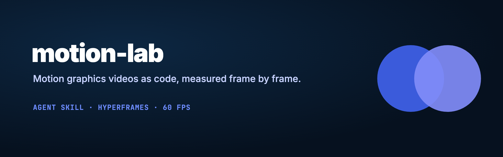
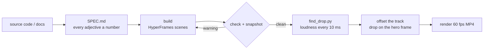

<a id="top"></a>



<p align="center">
  <a href="LICENSE"></a>
  
  
  
</p>

<p align="center"><b>An agent skill for motion graphics videos written as code.</b><br>
Product showcases, pipeline explainers and launch clips, with every adjective turned into a number and every frame checked.</p>

<p align="center"></p>
<p align="center"><sub>The reference build: 17 s, 1,020 frames, the music drop landing on the frame the logo circles touch.</sub></p>

## Contents

- [What it does](#what-it-does)
- [Quick start](#quick-start)
- [How it works](#how-it-works)
- [The numbers it works to](#the-numbers-it-works-to)
- [What's inside](#whats-inside)
- [Run the example](#run-the-example)
- [FAQ](#faq)
- [License](#license)

## What it does

You ask for "a motion graphics video of how X works". The agent:

1. reads the real source (repo, docs) and finds the mechanism worth showing
2. writes a `SPEC.md` where "smooth" becomes `expo.out, 0.55 s` and "punchy" becomes `back.out(1.4)`
3. builds one worked example that travels through the actual pipeline, one scene per stage
4. lints, snapshots and fixes frames by measurement, not by taste
5. finds the music drop and offsets the track so it lands on the hero frame
6. renders a square 60 fps MP4 and drafts the post

<p align="right"><a href="#top">back to top</a></p>

## Quick start

**Claude Code**

```bash
git clone https://github.com/codeswithroh/motion-lab ~/.claude/skills/motion-lab
```

```text
make a motion graphics video of how my repo's pipeline works
```

**Any other agent** (Cursor, Codex, Gemini CLI, ChatGPT): give it this link and say "read this skill and follow it".

```text
https://github.com/codeswithroh/motion-lab/blob/main/SKILL.md
```

Requirements: Node 18+, ffmpeg, Python 3 with numpy.

<p align="right"><a href="#top">back to top</a></p>

## How it works



HyperFrames renders HTML by seeking a paused GSAP timeline one frame at a time, so the same frame renders identically every time. The agent can't hear the track, so `scripts/find_drop.py` measures it: a loudness map in 10 ms windows, drops scored by the jump from the 0.3 s before to the 0.3 s after, and the `media-start` that puts the drop on a chosen frame.

<p align="right"><a href="#top">back to top</a></p>

## The numbers it works to

| What | Value |
|---|---|
| Arrival | `expo.out`, 0.5-0.6 s |
| Exit | `power3.in`, 40-50% shorter than the entrance |
| Typing | one letter every 2 frames at 60 fps |
| Hold to read | 0.5 s + 0.3 s a word, last line ≥ 2 s |
| Something new | every 2-4 s |
| Sound vs picture | sound peaks 0-1 frame after the picture event |
| Loudness | −16 to −14 LUFS, true peak ≤ −1 dBTP |

The full table, with fixes for common lint failures, is in [`references/numbers.md`](references/numbers.md).

<p align="right"><a href="#top">back to top</a></p>

## What's inside

| Path | What it is |
|---|---|
| [`SKILL.md`](SKILL.md) | The workflow: source, spec, story shape, look, build, check loop, music sync, delivery |
| [`references/numbers.md`](references/numbers.md) | Eases, durations, holds, text sizes, and lint fixes |
| [`references/spec-template.md`](references/spec-template.md) | The SPEC.md the agent fills in before building |
| [`references/sound.md`](references/sound.md) | Synthesizing a score from frame numbers when there's no track |
| [`scripts/find_drop.py`](scripts/find_drop.py) | Finds a track's drops and the offset that lands one on a frame |
| [`examples/cofoundr/`](examples/cofoundr) | The full reference build: scenes, spec, review notes, preview |

<p align="right"><a href="#top">back to top</a></p>

## Run the example

```bash
cd examples/cofoundr
npx hyperframes preview
```

The original track is licensed and not included. Put any track at `assets/audio/luxe.mp3`, then:

```bash
python3 ../../scripts/find_drop.py assets/audio/luxe.mp3 --hero 14.1
```

and set `data-media-start` in `index.html` to the value it prints.

<p align="right"><a href="#top">back to top</a></p>

## FAQ

<details><summary><b>Does it need a music track?</b></summary>

No. Without one it can synthesize a score from frame numbers (see `references/sound.md`), or render silent.
</details>

<details><summary><b>Why square?</b></summary>

1080x1080 plays well on both X and LinkedIn. HyperFrames renders any size; change the root composition's width and height.
</details>

<details><summary><b>What does "measured" mean here?</b></summary>

Every follow-up is a number: the frame the circles touch (846), the drop onset (14.115 s), the gap (15 ms, under one 16.7 ms frame). Nothing gets fixed by ear.
</details>

## License

[MIT](LICENSE). The bundled Instrument Serif font is under the SIL Open Font License 1.1 ([`FONT-LICENSE.txt`](examples/cofoundr/assets/fonts/FONT-LICENSE.txt)).

<p align="right"><a href="#top">back to top</a></p>
